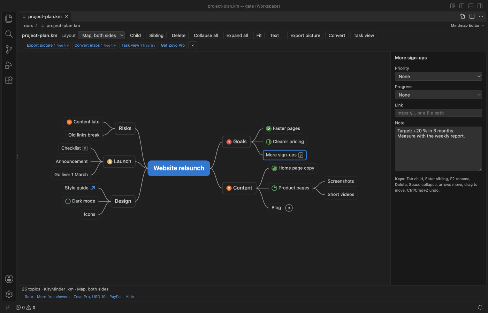

# Mindmap Editor (KM, MM & OPML)

Open .km, FreeMind .mm and OPML files as a mind map in VS Code and edit them with the keyboard. Every change is saved back to the same file in the same format. Made by Zovo.

Free, with no account and no network calls:

- Opens KityMinder `.km` files as a map when you click them. FreeMind and Freeplane `.mm` files and `.opml` outlines open from the right-click menu (Open in Mindmap Editor) or Open With.
- Edit with the keyboard: Tab adds a child topic, Enter adds a sibling, F2 renames, Delete removes a branch, Space collapses or expands it, and the arrow keys move between topics. Double-click a topic to rename it. Drag a topic onto another to move it there, or onto the top or bottom edge of a topic to put it before or after.
- Collapse and expand branches (one at a time or all at once), notes, priority 1 to 9, progress (0, 25, 50, 75 and 100 %) and links, set in the panel beside the map.
- Layouts: map with topics on both sides, right, left, tree and org chart. Colors follow your VS Code theme, dark or light.
- Saves back to the same format. Only the part of the file you changed is rewritten: other keys, attributes, styles and comments stay as they were, so the file still opens in other mind map programs and diffs cleanly in git.
- Undo, redo, save and the unsaved-changes dot work like in any VS Code editor. Open as text beside the map at any time.
- New Mind Map command for a new .km, .mm or .opml file.

Zovo Pro: USD 19 once, for the Pro tools in every Zovo extension. Each Pro tool has 1 free try on your computer first:

- Export picture: the whole map or the selected branch as PNG (1x, 2x or 4x poster size), SVG or PDF, with theme colors, a white background or a transparent one (PNG and SVG).
- Convert maps: between KityMinder .km, FreeMind .mm, OPML and a Markdown outline (headings and lists), one file or every map in a folder. Titles, notes, links, priority and progress go along. A Markdown outline turns into a map the same way.
- Task view: every topic in a table with its branch, priority, progress, note and link. Filter it by text, priority, progress or notes, click a row to go to the topic, and save the rows as CSV or Markdown.

The Pro tools are in the map toolbar, the Command Palette (Mindmap: ... (Pro)), the editor title menu and the right-click menu of a map file (Convert also on Markdown files and folders). The setting `zovoMindmap.showProTools` hides them.

Made by Zovo.

## Details

- `.km` is the JSON format of KityMinder maps. FreeMind 0.9 and 1.x and Freeplane `.mm` files are read and written as XML. In OPML, one outline in the body is the central topic; with several top outlines, the file title is shown as the central topic and is not written to the file.
- Where the format has no field of its own, the editor uses the usual one: FreeMind keeps priority as the `full-1` to `full-9` icons and progress as the `0%` to `100%` icons; OPML keeps notes in `_note`, links in `url`, and priority and progress in `_priority` and `_progress`.
- Collapsed branches are saved in .km and .mm files, like the other programs do. In OPML they are kept on screen only.
- A topic title written as rich text (HTML) in a .mm file is shown as plain text. When you rename such a topic, it is saved as plain text.
- Pictures, relations between topics and topic styles from other programs are kept in the file but not drawn.
- A file that cannot be read shows the reason and the line, and an Open as text button. Nothing is written until you edit.
- The layout you pick is a view setting and does not change the file.

## Settings

| Setting | Default | What it does |
|---|---|---|
| `zovoMindmap.showProTools` | true | Show the Zovo Pro tools in the toolbar and menus. |
| `zovoMindmap.askForRating` | true | Ask once for a rating after a few maps opened well. |
| `zovoMindmap.showSupportLinks` | true | The small Rate, More free tools and Zovo Pro links under the map. |

## Privacy

No telemetry, no account and no network requests. The only pages that open in your browser are the ones you click: a web link in a topic, the review page, or a Zovo Pro page.

## License

MIT. See THIRD-PARTY-NOTICES.md.
